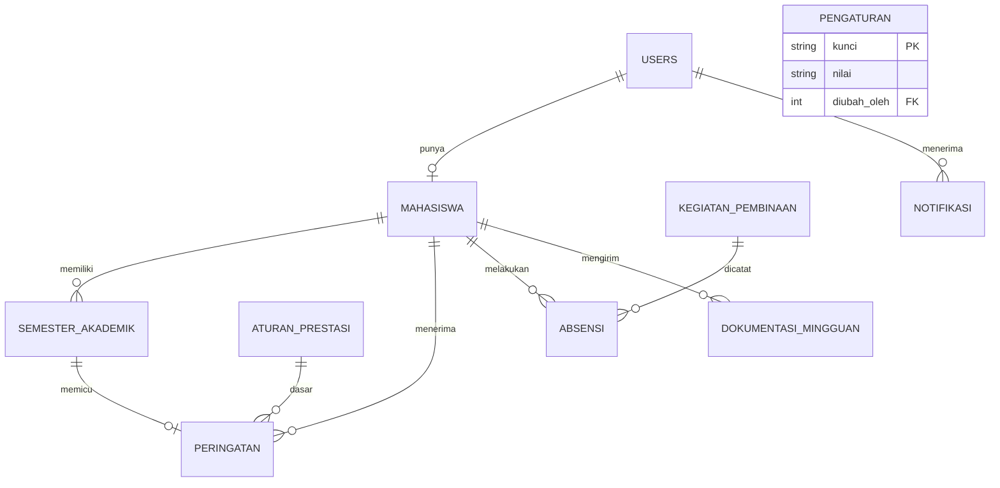

# Design — Website Manajemen Penerima KIP-K

> Rancangan teknis dan antarmuka. Kebutuhan ada di `prd.md`, teknologi di `techstack.md`.
> Skema database lengkap ada di `database/kipk_schema.sql` (sumber kebenaran untuk struktur tabel).

## 1. Arsitektur

Aplikasi monolit server-rendered dengan pola MVC.

```
Browser  →  Route  →  Middleware (auth, peran)  →  Controller
                                                       │
                                  FormRequest (validasi) / Policy (otorisasi)
                                                       │
                                                  Service (logika bisnis)
                                                       │
                                              Model (Eloquent)  →  MySQL
                                                       │
                                                    View (Blade)
```

Prinsip:
- Controller tipis; logika bisnis (misalnya evaluasi peringatan) berada di **Service**.
- Validasi di **FormRequest**, otorisasi di **Policy** dan middleware peran.
- File privat tidak pernah diakses lewat URL publik; selalu lewat controller yang memeriksa hak akses.

## 2. Struktur folder (inti)

```
app/
  Http/
    Controllers/
      Admin/        PenerimaController, NilaiController, AturanPrestasiController,
                    PeringatanController, KegiatanController, VerifikasiDokumentasiController,
                    LaporanController, AkunController, PengaturanController, DashboardController
      Mahasiswa/    DashboardController, NilaiController, PembinaanController,
                    DokumentasiController, NotifikasiController, ProfilController
      Auth/
    Middleware/     EnsureRole.php
    Requests/       (FormRequest per form)
  Models/           User, Mahasiswa, SemesterAkademik, AturanPrestasi, Peringatan,
                    KegiatanPembinaan, Absensi, DokumentasiMingguan, Notifikasi, Pengaturan
  Policies/         MahasiswaPolicy, SemesterAkademikPolicy, DokumentasiPolicy
  Services/         PeringatanService, AbsensiService, DokumentasiService, NotifikasiService
  Console/Commands/ KirimPengingatDokumentasi
database/
  migrations/  seeders/  kipk_schema.sql
resources/views/
  layouts/  admin/  mahasiswa/  components/
routes/web.php
tests/Feature  tests/Unit
```

## 3. Model data



Constraint penting (sudah ada di SQL):
- `semester_akademik`: unik `(mahasiswa_id, semester_ke)`; `ips` dan `ipk` 0–4.
- `absensi`: unik `(kegiatan_id, mahasiswa_id)`.
- `dokumentasi_mingguan`: unik `(mahasiswa_id, tahun, minggu_ke)`.
- `peringatan`: unik `(mahasiswa_id, semester_id)`.
- `aturan_prestasi`: `berlaku_mulai` unik.
- `pengaturan`: `kunci` unik; berisi `dokumentasi_tenggat_hari` (1 = Senin ... 7 = Minggu), `dokumentasi_tenggat_jam` (HH:MM), dan `peringatan_batas_pencabutan` (jumlah).

Penyesuaian Laravel: tambahkan `updated_at` bila dibutuhkan, dan catat di sini setiap penyimpangan dari `kipk_schema.sql`.

Penyimpangan yang sudah dicatat:
- `users.password_hash` pada SQL dipakai sebagai kolom `password` di migrasi (nama bawaan autentikasi Laravel).
- Migrasi `semester_akademik`, `aturan_prestasi`, `peringatan`, dan `pengaturan` mengikuti kolom skema; ID memakai `id()`/`foreignId()` Laravel. Check IPS/IPK dipasang lewat SQL pada driver selain SQLite.
- `semester_akademik.created_at` menandai tanggal pertama nilai dimasukkan dan menjadi tanggal untuk memilih aturan prestasi; koreksi nilai mempertahankan tanggal tersebut.
- KHS disimpan melalui disk `local` yang berakar di `storage/app/private`; unduhan admin dan mahasiswa hanya lewat controller, dengan pemeriksaan pemilik untuk mahasiswa.
- Aturan prestasi yang sudah berlaku atau telah menjadi dasar peringatan tidak dapat dihapus agar riwayat evaluasi terjaga. Aturan mendatang yang belum dipakai dapat dihapus.
- Nama tabel tetap tunggal seperti di SQL (`mahasiswa`, `absensi`, dst.), jadi model perlu `protected $table = '...'`.
- Tabel `password_reset_tokens` bawaan Laravel dihapus; reset password dilakukan admin (FR-18).
- Kolom `angkatan` memakai `unsignedSmallInteger` (tipe `YEAR` MySQL tidak tersedia di Schema Builder).
- Migrasi Laravel menggunakan `id()`/`foreignId()` serta `timestamps()` untuk `users` dan `mahasiswa`; SQL asal memakai integer unsigned dan hanya `created_at`.

## 4. Matriks otorisasi

| Sumber daya | Admin | Mahasiswa |
|---|---|---|
| Data penerima | CRUD | Lihat profil sendiri |
| Nilai (`semester_akademik`) | CRUD | **Baca** milik sendiri |
| File KHS | Baca/unggah | Baca milik sendiri |
| Aturan prestasi | CRUD | Baca batas yang berlaku |
| Peringatan | Baca semua | Baca milik sendiri |
| Kegiatan pembinaan | CRUD | Baca |
| Absensi | Baca semua, koreksi status | Buat milik sendiri (dalam jendela waktu), baca milik sendiri |
| Dokumentasi | Baca semua, verifikasi | Buat dan baca milik sendiri |
| Notifikasi | Baca milik sendiri | Baca milik sendiri |
| Pengaturan (tenggat, batas pencabutan) | Baca dan ubah | Baca tenggat saja |
| Status KIP-K `dicabut` | Ubah dengan konfirmasi | Tidak ada akses |

Aturan wajib: pada sisi mahasiswa, `mahasiswa_id` **selalu diambil dari sesi login**, tidak dari URL atau form.

## 5. Logika bisnis utama

### 5.1 Evaluasi peringatan (`PeringatanService`)
Dipanggil setelah nilai semester disimpan atau dikoreksi.

```
evaluasi(Mahasiswa $m):
  batas_cabut = pengaturan.peringatan_batas_pencabutan (nilai awal 3)
  rangkaian = 0
  sebelumnya = null
  untuk setiap semester s milik m (urut semester_ke):
    aturan = AturanPrestasi terbaru dengan berlaku_mulai <= tanggal input s
    di_bawah = s.ipk < aturan.ipk_minimal
    jika di_bawah:
      jika sebelumnya di_bawah dan sebelumnya.semester_ke == s.semester_ke - 1:
        rangkaian = rangkaian + 1
      jika tidak:
        rangkaian = 1
      tingkat[s] = rangkaian
    jika tidak:
      rangkaian = 0
    sebelumnya = s
  sinkronkan tabel peringatan: satu baris per semester yang di_bawah dengan tingkat di atas,
    hapus baris untuk semester yang tidak lagi di bawah (nilai dikoreksi)
  untuk peringatan yang baru dibuat:
    jika tingkat < batas_cabut: notifikasi ke mahasiswa (pesan peringatan evaluasi)
    jika tingkat >= batas_cabut: notifikasi ke mahasiswa dan ke semua admin
                                 ("memenuhi syarat pencabutan")
```

Tingkat dihitung berurutan: IPK yang kembali memenuhi batas pada semester berikutnya mengembalikan rangkaian ke nol. Semester yang tidak punya data memutus rangkaian, jadi admin perlu menginput semua semester.

`PeringatanService` menyinkronkan baris peringatan saja. Ambang pencabutan dibaca dari `pengaturan.peringatan_batas_pencabutan` (default 3) untuk menandai tingkat yang memenuhi ambang; layanan tidak mengubah status KIP-K atau membuat notifikasi. Titik pemanggilan notifikasi disediakan setelah evaluasi di controller nilai untuk T-205.

Pencabutan tidak otomatis. Admin membuka halaman Peringatan, meninjau, lalu menekan "Cabut KIP-K" (dengan konfirmasi) yang mengubah `mahasiswa.status_kipk` menjadi `dicabut`.

### 5.2 Absensi (`AbsensiService`)
Pengamanan hanya berupa jendela waktu; tidak memakai kode sesi, QR, atau geolokasi.

1. Ambil kegiatan; tolak bila `now` di luar `[absen_buka, absen_tutup]`.
2. Tolak bila sudah ada absensi (cek di aplikasi dan dijaga unique key).
3. Simpan dengan `waktu = now`, `status = hadir`.

### 5.3 Dokumentasi mingguan (`DokumentasiService`)
1. Tentukan `tahun` dan `minggu_ke` dari tanggal sekarang (ISO week).
2. Tolak bila sudah ada kiriman minggu itu, kecuali statusnya `ditolak` (boleh kirim ulang).
3. Validasi file: JPG/PNG, maks. 5 MB; kompres bila lebih dari batas lebar.
4. Simpan di `private/dokumentasi/{mahasiswa_id}/{tahun}-{minggu}.jpg`, status `menunggu`.
5. Verifikasi admin mengubah status dan mengirim notifikasi hasil.
6. Tenggat dibaca dari `pengaturan` (`dokumentasi_tenggat_hari`, `dokumentasi_tenggat_jam`). Kiriman setelah tenggat tetap diterima dan ditandai "terlambat", dihitung dengan membandingkan `created_at` dengan tenggat minggu itu (tanpa kolom baru).

### 5.4 Pengingat (`KirimPengingatDokumentasi`)
Dijadwalkan harian; membuat notifikasi bagi mahasiswa aktif yang belum mengirim pada minggu berjalan menjelang tenggat yang diatur admin di tabel `pengaturan`.

## 6. Rute utama

| Metode | Path | Peran | Fungsi |
|---|---|---|---|
| GET/POST | `/login`, `/logout` | publik/semua | Autentikasi |
| GET | `/admin/dashboard` | admin | Dashboard admin |
| Resource | `/admin/penerima` | admin | CRUD penerima |
| POST | `/admin/penerima/import` | admin | Impor Excel |
| Resource | `/admin/penerima/{id}/nilai` | admin | Nilai per semester + unggah KHS |
| Resource | `/admin/aturan-prestasi` | admin | Batas IPK |
| GET | `/admin/peringatan` | admin | Daftar peringatan |
| Resource | `/admin/kegiatan` | admin | Kegiatan pembinaan, rekap absensi |
| GET/PATCH | `/admin/dokumentasi` | admin | Antrean dan verifikasi |
| GET | `/admin/laporan/{jenis}` | admin | Ekspor PDF/Excel |
| GET/PUT | `/admin/pengaturan` | admin | Tenggat dokumentasi dan batas pencabutan |
| POST | `/admin/peringatan/{mahasiswa}/cabut` | admin | Cabut KIP-K (dengan konfirmasi) |
| GET | `/mahasiswa/dashboard` | mahasiswa | Dashboard |
| GET | `/mahasiswa/nilai` | mahasiswa | Nilai (read-only) |
| GET | `/mahasiswa/khs/{semester}` | mahasiswa | Unduh KHS sendiri |
| GET/POST | `/mahasiswa/pembinaan`, `/mahasiswa/pembinaan/{id}/absen` | mahasiswa | Daftar dan absen |
| GET/POST | `/mahasiswa/dokumentasi` | mahasiswa | Riwayat dan unggah |
| GET | `/mahasiswa/notifikasi` | mahasiswa | Notifikasi |

Untuk pembuatan akun penerima, `users.username` mengikuti NIM. Admin menetapkan password awal (minimal 8 karakter); impor menerima kolom `password`, memvalidasi tiap baris, lalu menyimpan hash tanpa menyimpan berkas impor. Status `dicabut` memerlukan konfirmasi eksplisit di form atau kolom `konfirmasi_pencabutan` pada impor.

## 7. Rancangan antarmuka

### 7.1 Navigasi
- **Admin:** sidebar kiri — Dashboard, Data Penerima, Nilai Akademik, Aturan Prestasi, Peringatan, Kegiatan Pembinaan, Verifikasi Dokumentasi, Laporan, Akun, Pengaturan.
- **Mahasiswa:** bottom navigation di ponsel / top navbar di desktop — Beranda, Nilai, Pembinaan, Dokumentasi, Notifikasi, Profil.

### 7.2 Halaman dan komponen kunci

| Halaman | Komponen |
|---|---|
| Login | Form username/password, pesan galat jelas |
| Dashboard admin | 4 kartu ringkasan, grafik per prodi (Chart.js), tabel mahasiswa bermasalah |
| Data penerima | Tabel + pencarian + filter status/prodi/angkatan + paginasi, tombol impor |
| Form nilai | Pilih semester, input IPS/IPK/SKS, unggah KHS PDF, konfirmasi sebelum simpan |
| Kegiatan | Daftar, form jadwal, tombol buka/tutup absen, tabel rekap |
| Verifikasi dokumentasi | Kartu foto + tombol Terima/Tolak + kolom catatan; penanda "terlambat" |
| Peringatan (admin) | Daftar mahasiswa per tingkat, penanda "pencabutan" pada tingkat di atas atau sama dengan batas, tombol Cabut KIP-K dengan konfirmasi |
| Pengaturan (admin) | Form hari dan jam tenggat dokumentasi, batas jumlah peringatan untuk pencabutan, simpan dengan konfirmasi |
| Dashboard mahasiswa | Banner peringatan (bila ada), IPK terakhir, status KIP-K, kehadiran %, status dokumentasi minggu ini |
| Nilai saya | Tabel semester, grafik IPK, tautan KHS, indikator posisi terhadap batas |
| Pembinaan | Daftar kegiatan, tombol Absen (aktif hanya saat sesi), riwayat |
| Dokumentasi | Form unggah dengan pratinjau, status, riwayat |

### 7.3 Pedoman visual
- **Warna:** biru tua sebagai primer, abu netral untuk latar; status memakai hijau (aman/diterima), kuning (menunggu), merah (peringatan/ditolak).
- **Tipografi:** satu keluarga sans-serif (mis. Inter), ukuran dasar 16 px.
- **Komponen:** Bootstrap 5 dengan sedikit kustomisasi; konsisten antar halaman.
- **Responsif:** mobile-first; tabel lebar dalam kontainer scroll horizontal.
- **Aksesibilitas:** kontras cukup, label pada setiap input, status tidak hanya dibedakan lewat warna (sertakan teks/ikon).
- **Keadaan kosong dan galat:** setiap daftar punya pesan "belum ada data"; setiap form menampilkan galat di dekat kolomnya.

### 7.4 Alur utama

**Admin:** Login → Nilai Akademik → pilih mahasiswa → isi IPS/IPK/SKS + unggah KHS → simpan → `PeringatanService` → notifikasi bila di bawah batas.

**Mahasiswa:** Login → Dashboard → (Nilai | Pembinaan → Absen | Dokumentasi → Unggah → status menunggu → hasil di Notifikasi).

## 8. Keamanan

- Password: bcrypt; kebijakan panjang minimal 8.
- CSRF token di semua form; escape output Blade (`{{ }}`).
- Unggahan: validasi MIME dan ekstensi, nama file di-generate sistem, simpan di disk privat.
- Pembatasan percobaan login (rate limiting).
- Header keamanan dan HTTPS di produksi; `APP_DEBUG=false`.
- Jangan pernah menaruh `mahasiswa_id` sebagai input yang dipercaya pada sisi mahasiswa.

## 9. Pengujian

| Jenis | Fokus |
|---|---|
| Unit | `PeringatanService` (di bawah/di atas batas, tingkat 1-2-3 berurutan, rangkaian reset saat IPK memenuhi batas, semester tanpa data memutus rangkaian, koreksi nilai menghapus peringatan), penentuan minggu ISO |
| Feature | Otorisasi (mahasiswa tidak bisa melihat data lain), jendela absensi, unik absensi/dokumentasi, validasi unggahan |
| Manual | Alur lengkap admin dan mahasiswa di ponsel dan desktop |

## 10. Keputusan dan pertanyaan desain
Lihat bagian 11 di `prd.md` (keputusan pemilik proyek dan asumsi sementara).

Keputusan 2026-10-24:
- Absensi hanya memakai jendela waktu.
- Tenggat dokumentasi diatur admin lewat tabel `pengaturan`.
- Peringatan: tingkat dihitung berurutan (semester berturut-turut); 1-2 pesan evaluasi, tingkat 3 ke atas ditandai pencabutan dan dikonfirmasi admin.
- Tiga akun admin setara.
