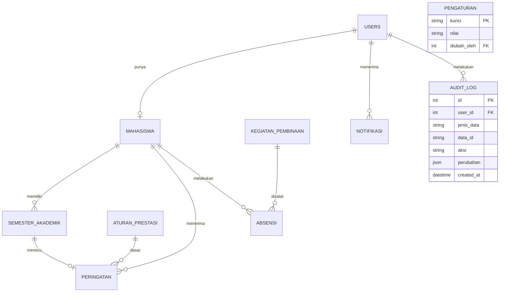

# Design — Website Manajemen Penerima KIP-K

> Rancangan teknis dan antarmuka. Kebutuhan ada di `prd.md`, teknologi di `techstack.md`.
> Skema database lengkap ada di `database/kipk_schema.sql` (sumber kebenaran untuk struktur tabel).

## 1. Arsitektur

Aplikasi monolit server-rendered dengan pola MVC.

```
Browser  →  Route  →  Middleware (auth, peran)  →  Controller
                                                       │
                                  FormRequest (validasi) / Policy (otorisasi)
                                                       │
                                                  Service (logika bisnis)
                                                       │
                                              Model (Eloquent)  →  MySQL
                                                       │
                                                    View (Blade)
```

Prinsip:
- Controller tipis; logika bisnis (misalnya evaluasi peringatan) berada di **Service**.
- Validasi di **FormRequest**, otorisasi di **Policy** dan middleware peran.
- File privat tidak pernah diakses lewat URL publik; selalu lewat controller yang memeriksa hak akses.

## 2. Struktur folder (inti)

```
app/
  Http/
    Controllers/
      Admin/        PenerimaController, NilaiController, AturanPrestasiController,
                    PeringatanController, KegiatanController,
                    LaporanController, AkunController, AuditLogController, PengaturanController, DashboardController
      Mahasiswa/    DashboardController, NilaiController, PembinaanController,
                    NotifikasiController
      Auth/
    Middleware/     EnsureRole.php
    Requests/       (FormRequest per form)
  Models/           User, Mahasiswa, SemesterAkademik, AturanPrestasi, Peringatan,
                    KegiatanPembinaan, Absensi, Notifikasi, Pengaturan
  Services/         PeringatanService, AbsensiService, NotifikasiService
  Console/Commands/ BackupKipk, BuatAdmin
database/
  migrations/  seeders/  kipk_schema.sql
resources/views/
  layouts/  admin/  mahasiswa/  components/
routes/web.php
tests/Feature  tests/Unit
```

## 3. Model data



Constraint penting (sudah ada di SQL):
- `semester_akademik`: unik `(mahasiswa_id, semester_ke)`; `ips` dan `ipk` 0–4.
- `absensi`: unik `(kegiatan_id, mahasiswa_id)`.
- `absensi.file_foto` menyimpan jalur privat foto bukti yang dikirim mahasiswa (nullable agar baris lama tetap kompatibel). Admin meninjau foto tersebut dan hanya mengubah status; koreksi admin mempertahankan foto serta waktu kirim, tanpa unggah foto baru.
- `peringatan`: unik `(mahasiswa_id, semester_id)`.
- `aturan_prestasi`: `berlaku_mulai` unik.
- `pengaturan`: `kunci` unik; berisi `peringatan_batas_pencabutan` (jumlah).

Penyesuaian Laravel: tambahkan `updated_at` bila dibutuhkan, dan catat di sini setiap penyimpangan dari `kipk_schema.sql`.

Penyimpangan yang sudah dicatat:
- `users.password_hash` pada SQL dipakai sebagai kolom `password` di migrasi (nama bawaan autentikasi Laravel).
- Migrasi `semester_akademik`, `aturan_prestasi`, `peringatan`, `pengaturan`, dan `notifikasi` mengikuti kolom skema; ID memakai `id()`/`foreignId()` Laravel. Check IPS/IPK dipasang lewat SQL pada driver selain SQLite.
- Migrasi `kegiatan_pembinaan` dan `absensi` mengikuti tabel SQL, termasuk `chk_jam_absen` dan unique key `uq_absen`. MySQL memakai CHECK constraint; SQLite untuk tes menegakkan syarat waktu yang sama lewat trigger.
- Foto absensi disimpan di disk privat `local` pada `private/absensi/{kegiatan_id}/{mahasiswa_id}/{nama-acak}.{jpg|png}`. Timestamp `absensi.waktu` ditetapkan server ketika foto diterima; foto disajikan lewat controller berotorisasi.
- `semester_akademik.created_at` menandai tanggal pertama nilai dimasukkan dan menjadi tanggal untuk memilih aturan prestasi; koreksi nilai mempertahankan tanggal tersebut.
- KHS disimpan melalui disk `local` yang berakar di `storage/app/private`; unduhan admin dan mahasiswa hanya lewat controller, dengan pemeriksaan pemilik untuk mahasiswa.
- Aturan prestasi yang sudah berlaku atau telah menjadi dasar peringatan tidak dapat dihapus agar riwayat evaluasi terjaga. Aturan mendatang yang belum dipakai dapat dihapus.
- Nama tabel tetap tunggal seperti di SQL (`mahasiswa`, `absensi`, dst.), jadi model perlu `protected $table = '...'`.
- Tabel `password_reset_tokens` bawaan Laravel dihapus; reset password dilakukan admin (FR-18).
- Kolom `angkatan` memakai `unsignedSmallInteger` (tipe `YEAR` MySQL tidak tersedia di Schema Builder).
- Migrasi Laravel menggunakan `id()`/`foreignId()` serta `timestamps()` untuk `users` dan `mahasiswa`; SQL asal memakai integer unsigned dan hanya `created_at`.
- Zona waktu aplikasi default `Asia/Jakarta` (dapat ditimpa lewat `APP_TIMEZONE`); jadwal dan waktu absensi mengikuti zona waktu aplikasi.
- Migrasi `audit_log` (FR-19/T-506) menyimpan aktor admin, tabel dan ID data, aksi, perubahan field dalam JSON, serta waktu. Observer mencatat nilai semester (`semester_ke`, IPS, IPK, SKS), status KIP-K, nilai aturan prestasi, dan nilai pengaturan saat dibuat/diubah/dihapus. Kolom KHS/foto, password, NIM, dan data mahasiswa lain tidak disalin ke log; pencatatan hanya berjalan untuk aktor admin yang sedang login. Admin dapat menelusuri log lewat halaman baca-saja dengan filter.
- Migrasi indeks tambahan mencakup filter status/prodi/angkatan mahasiswa, waktu kegiatan, daftar absensi, peringatan, notifikasi, dan audit log. Uji dashboard dengan 500 mahasiswa memastikan jumlah query tetap terbatas; waktu respons pada server produksi masih perlu diukur setelah deployment.

## 3.1 Operasional

- Admin produksi dibuat melalui `php artisan kipk:admin-create`, bukan akun demo seeder.
- `php artisan kipk:backup` membuat arsip ZIP AES-256 berisi dump MySQL dan berkas privat; scheduler menjalankannya setiap hari pukul 01.15 sesuai zona waktu aplikasi. Dump SQL sementara berada di storage lokal dan dibersihkan setelah perintah selesai.
- Simpan arsip pada volume di luar document root dan direktori privat, salin ke lokasi off-site, simpan rahasia enkripsi secara terpisah, dan lakukan pemulihan berkala ke staging. Prosedur lengkap ada di `docs/persiapan-rilis.md`.

## 4. Matriks otorisasi

| Sumber daya | Admin | Mahasiswa |
|---|---|---|
| Data penerima | CRUD | Lihat profil sendiri |
| Nilai (`semester_akademik`) | CRUD | **Baca** milik sendiri |
| File KHS | Baca/unggah | Baca milik sendiri |
| Aturan prestasi | CRUD | Baca batas yang berlaku |
| Peringatan | Baca semua | Baca milik sendiri |
| Kegiatan pembinaan | CRUD | Baca |
| Absensi | Baca semua dan foto bukti, setujui/tolak dengan mengubah status | Buat milik sendiri (dalam jendela waktu, wajib foto), baca milik sendiri |
| Foto absensi | Baca semua lewat controller | Baca milik sendiri lewat controller |
| Notifikasi | Baca milik sendiri | Baca milik sendiri |
| Audit log | Baca | Tidak ada akses |
| Pengaturan batas pencabutan | Baca dan ubah | Tidak ada akses |
| Status KIP-K `dicabut` | Ubah dengan konfirmasi | Tidak ada akses |

Aturan wajib: pada sisi mahasiswa, `mahasiswa_id` **selalu diambil dari sesi login**, tidak dari URL atau form.

## 5. Logika bisnis utama

### 5.1 Evaluasi peringatan (`PeringatanService`)
Dipanggil setelah nilai semester disimpan atau dikoreksi.

```
evaluasi(Mahasiswa $m):
  batas_cabut = pengaturan.peringatan_batas_pencabutan (nilai awal 3)
  rangkaian = 0
  sebelumnya = null
  untuk setiap semester s milik m (urut semester_ke):
    aturan = AturanPrestasi terbaru dengan berlaku_mulai <= tanggal input s
    di_bawah = s.ipk < aturan.ipk_minimal
    jika di_bawah:
      jika sebelumnya di_bawah dan sebelumnya.semester_ke == s.semester_ke - 1:
        rangkaian = rangkaian + 1
      jika tidak:
        rangkaian = 1
      tingkat[s] = rangkaian
    jika tidak:
      rangkaian = 0
    sebelumnya = s
  sinkronkan tabel peringatan: satu baris per semester yang di_bawah dengan tingkat di atas,
    hapus baris untuk semester yang tidak lagi di bawah (nilai dikoreksi)
  untuk peringatan yang baru dibuat atau yang tingkatnya baru mencapai ambang:
    jika tingkat < batas_cabut: notifikasi ke mahasiswa (pesan peringatan evaluasi)
    jika tingkat >= batas_cabut: notifikasi ke mahasiswa dan ke semua admin
                                 ("memenuhi syarat pencabutan")
```

Tingkat dihitung berurutan: IPK yang kembali memenuhi batas pada semester berikutnya mengembalikan rangkaian ke nol. Semester yang tidak punya data memutus rangkaian, jadi admin perlu menginput semua semester.

`PeringatanService` menyinkronkan baris peringatan dan memanggil `NotifikasiService` ketika baris peringatan dibuat atau tingkat yang tersimpan baru melewati ambang. Evaluasi berulang tidak menggandakan notifikasi untuk peringatan yang sama. Ambang pencabutan dibaca dari `pengaturan.peringatan_batas_pencabutan` (default 3); tingkat di bawah ambang memberi notifikasi evaluasi ke mahasiswa, sedangkan tingkat yang mencapai ambang memberi notifikasi ke mahasiswa dan semua admin. Layanan tidak mengubah status KIP-K.

Pencabutan tidak otomatis. Admin membuka halaman Peringatan, meninjau, lalu menekan "Cabut KIP-K" (dengan konfirmasi) yang mengubah `mahasiswa.status_kipk` menjadi `dicabut`.

### 5.2 Absensi (`AbsensiService`)
Absensi dibatasi jendela waktu dan wajib menyertakan foto JPG/PNG maksimal 5 MB. Tidak memakai kode sesi, QR, atau geolokasi. File disimpan privat dengan nama acak; `waktu` berasal dari jam server aplikasi saat file diterima, bukan metadata/perangkat.

1. Ambil kegiatan; tolak bila `now` di luar `[absen_buka, absen_tutup]`.
2. Validasi dan simpan foto ke disk privat.
3. Tolak bila sudah ada absensi (cek di aplikasi dan dijaga unique key).
4. Simpan dengan `mahasiswa_id` dari sesi login, `waktu` server, dan `status = hadir`.

Admin meninjau foto yang telah dikirim mahasiswa pada rekap, lalu menetapkan status hadir/izin/alpa tanpa unggah foto baru. Persetujuan sebagai hadir memerlukan foto absensi mahasiswa; koreksi mempertahankan foto dan waktu kirim asli. Untuk mahasiswa yang tidak mengirim absensi, admin dapat mencatat izin atau alpa tanpa foto. Mahasiswa hanya dapat melihat foto absensinya sendiri, sedangkan admin dapat meninjau semua foto lewat controller. `mahasiswa_id` absensi mahasiswa dibuat dari relasi pada sesi login. Tombol mahasiswa nonaktif di luar jendela dan menjelaskan waktu buka/tutup. Rekap kegiatan menampilkan semua penerima dengan `status_kipk=aktif`; yang belum punya baris absensi ditampilkan `Tidak hadir`. Rekap persentase mahasiswa memakai kegiatan yang waktu tutupnya sudah lewat sebagai penyebut, sehingga kegiatan yang belum selesai tidak menurunkan angka.

## 6. Rute utama

| Metode | Path | Peran | Fungsi |
|---|---|---|---|
| GET/POST | `/login` | publik | Login manual dengan username/kata sandi; lima percobaan gagal per IP dalam 60 detik |
| POST | `/logout` | semua pengguna masuk | Mengakhiri sesi |
| GET | `/admin/dashboard` | admin | Dashboard admin |
| Resource | `/admin/penerima` | admin | CRUD penerima |
| POST | `/admin/penerima/import` | admin | Impor Excel |
| Resource | `/admin/penerima/{id}/nilai` | admin | Nilai per semester + unggah KHS |
| Resource | `/admin/aturan-prestasi` | admin | Batas IPK |
| GET | `/admin/peringatan` | admin | Daftar peringatan |
| Resource | `/admin/kegiatan` | admin | CRUD kegiatan dan rekap absensi per kegiatan |
| POST | `/admin/kegiatan/{id}/absensi/{mahasiswa}` | admin | Setujui/tolak absensi dengan menetapkan status berdasarkan bukti foto mahasiswa |
| GET | `/admin/absensi/{absensi}/foto` | admin | Lihat foto absensi melalui controller |
| GET | `/admin/rekap/mahasiswa/{mahasiswa}/kehadiran` | admin | Rekap kegiatan per mahasiswa |
| GET | `/admin/laporan` | admin | Halaman pilih laporan dan filter |
| GET | `/admin/laporan/{jenis}/excel` | admin | Ekspor rekap nilai atau kehadiran dalam XLSX |
| GET | `/admin/laporan/pdf-semester` | admin | Unduh laporan nilai semester dalam PDF |
| GET/PUT | `/admin/pengaturan` | admin | Batas jumlah peringatan untuk pencabutan |
| GET | `/admin/akun` | admin | Daftar akun, pencarian, dan filter peran |
| GET | `/admin/audit-log` | admin | Telusuri riwayat perubahan dengan filter |
| PUT | `/admin/akun/{id}/password` | admin | Reset password dengan konfirmasi |
| PUT | `/admin/akun/{id}/status` | admin | Aktifkan/nonaktifkan akun; cegah nonaktifkan diri sendiri atau admin aktif terakhir |
| POST | `/admin/peringatan/{mahasiswa}/cabut` | admin | Cabut KIP-K (dengan konfirmasi) |
| GET | `/mahasiswa/dashboard` | mahasiswa | Dashboard |
| GET | `/mahasiswa/nilai` | mahasiswa | Nilai (read-only) |
| GET | `/mahasiswa/khs/{semester}` | mahasiswa | Unduh KHS sendiri |
| GET/POST | `/mahasiswa/pembinaan`, `/mahasiswa/pembinaan/{kegiatan}/absen` | mahasiswa | Kegiatan, absen, dan rekap kehadiran sendiri |
| GET | `/mahasiswa/absensi/{absensi}/foto` | mahasiswa | Lihat foto absensi milik sendiri melalui controller |
| GET | `/mahasiswa/notifikasi` | mahasiswa | Notifikasi |

Untuk pembuatan akun penerima, `users.username` mengikuti NIM. Admin menetapkan password awal (minimal 8 karakter); impor menerima kolom `password`, memvalidasi tiap baris, lalu menyimpan hash tanpa menyimpan berkas impor. Status `dicabut` memerlukan konfirmasi eksplisit di form atau kolom `konfirmasi_pencabutan` pada impor.

Manajemen akun admin dapat mereset password semua akun dan menonaktifkan akun lain; akun yang sedang digunakan dan admin aktif terakhir tidak dapat dinonaktifkan. Akun nonaktif ditolak oleh middleware peran pada setiap permintaan.

## 7. Rancangan antarmuka

### 7.1 Navigasi
- **Aplikasi admin:** top navbar dengan Dashboard, Penerima & nilai, Aturan prestasi, Peringatan, Pembinaan, Laporan, Pengaturan, Manajemen akun, dan Notifikasi.
- **Aplikasi mahasiswa:** top navbar dengan Beranda, Nilai saya, Pembinaan, dan Notifikasi.
- **Responsif:** pada layar sempit, navigasi tetap di baris tersendiri dan dapat digulir horizontal; tombol Keluar tetap terlihat di samping identitas KIP-K.
- **Prototipe:** beberapa layar masih menampilkan eksplorasi sidebar admin dan navigasi bawah mahasiswa.

### 7.2 Halaman dan komponen kunci

| Halaman | Komponen |
|---|---|
| Login | Form username/password, pesan galat jelas |
| Dashboard admin | 4 kartu ringkasan, grafik per prodi dan angkatan (Chart.js), tabel mahasiswa bermasalah |
| Data penerima | Tabel + pencarian + filter status/prodi/angkatan + paginasi, tombol impor |
| Form nilai | Pilih semester, input IPS/IPK/SKS, unggah KHS PDF, konfirmasi sebelum simpan |

### 7.3 Aturan konsistensi visual dan teks

- **Warna:** seluruh layar dan prototipe memakai palet tema bersama. Aksi utama/sukses memakai hijau KIP-K; informasi memakai teal; peringatan memakai amber; bahaya memakai merah; keadaan netral memakai abu-abu.
- **Ukuran huruf:** gunakan Inter untuk isi, Merriweather untuk judul, 16 px sebagai ukuran dasar, satu skala untuk judul halaman dan subjudul, serta ukuran kecil hanya untuk label ringkasan.
- **Jarak:** judul halaman memiliki jarak bawah 16 px; judul dalam baris aksi mengikuti jarak baris; kartu memakai radius dan bayangan yang sama.
- **Tombol:** semua ukuran tombol memiliki tinggi minimum 44 px; warna tombol mengikuti arti aksinya dan bentuk outline hanya untuk aksi sekunder.
- **Badge status:** gunakan komponen `x-status-badge` pada status data. Ukuran, padding, bentuk pil, label, dan pemetaan warna status konsisten di admin dan mahasiswa.
- **Teks:** gunakan Bahasa Indonesia dan kapitalisasi kalimat (huruf kapital hanya di awal kalimat, nama diri, serta singkatan). Pakai istilah “Nama pengguna”, “Kata sandi”, dan “Atur ulang” secara konsisten.
- **Navigasi:** tandai halaman aktif dengan garis aksen dan latar yang jelas; animasi hover/fokus berlangsung 180 ms dan dinonaktifkan bila pengguna memilih pengurangan gerak.
| Kegiatan | Daftar, form jadwal, tombol buka/tutup absen, tabel rekap |
| Peringatan (admin) | Daftar mahasiswa per tingkat, penanda "pencabutan" pada tingkat di atas atau sama dengan batas, tombol Cabut KIP-K dengan konfirmasi |
| Pengaturan (admin) | Form batas jumlah peringatan untuk pencabutan, simpan dengan konfirmasi |
| Dashboard mahasiswa | Banner peringatan (bila ada), IPK terakhir, status KIP-K, kehadiran % |
| Laporan (admin) | Form ekspor Excel untuk nilai dan kehadiran dengan filter prodi/angkatan; nilai dan PDF juga memakai filter semester |
| Nilai saya | Tabel semester, grafik IPK, tautan KHS, indikator posisi terhadap batas |
| Pembinaan | Daftar kegiatan, tombol Absen (aktif hanya saat sesi), riwayat |
| Kegiatan (admin) | Form jadwal, rekap semua mahasiswa aktif, tinjau foto kiriman mahasiswa dan koreksi status hadir/izin/alpa tanpa unggah ulang |

### 7.3 Pedoman visual
- **Warna:** biru tua sebagai primer, abu netral untuk latar; status memakai hijau (aman/diterima), kuning (menunggu), merah (peringatan/ditolak).
- **Tipografi:** satu keluarga sans-serif (mis. Inter), ukuran dasar 16 px.
- **Komponen:** Bootstrap 5 dengan sedikit kustomisasi; konsisten antar halaman.
- **Responsif:** mobile-first; tabel lebar dalam kontainer scroll horizontal.
- **Aksesibilitas:** kontras cukup, label pada setiap input, status tidak hanya dibedakan lewat warna (sertakan teks/ikon).
- **Keadaan kosong dan galat:** setiap daftar punya pesan "belum ada data"; setiap form menampilkan galat di dekat kolomnya.
- **Dashboard:** kehadiran rendah berarti kurang dari 75% kegiatan pembinaan yang sudah ditutup; ambang ini disetujui pemilik proyek pada 2026-10-25 dan berada di `config/dashboard.php`.

### 7.4 Alur utama

**Admin:** Login → Nilai Akademik → pilih mahasiswa → isi IPS/IPK/SKS + unggah KHS → simpan → `PeringatanService` → notifikasi bila di bawah batas.

**Mahasiswa:** Login → Dashboard → (Nilai | Pembinaan → Absen dengan foto bukti).

## 8. Keamanan

- Password: bcrypt; kebijakan panjang minimal 8.
- CSRF token di semua form; escape output Blade (`{{ }}`).
- Unggahan: validasi MIME dari isi file, nama file di-generate sistem, simpan di disk privat.
- Foto bukti absensi dibatasi 5 MB dan 8 juta piksel sebelum didekode; batas piksel diatur di `config/absensi.php`.
- Foto absensi disajikan hanya melalui controller admin atau controller pemilik yang memeriksa otorisasi; tidak ada URL publik untuk file.
- Pembatasan percobaan login (rate limiting).
- Rute web mengirim header `nosniff`, `X-Frame-Options`, `Referrer-Policy`, dan `Permissions-Policy`; HSTS dikirim hanya untuk HTTPS di production. Cookie sesi otomatis `Secure` pada `APP_ENV=production` dan tetap dapat diatur lewat `SESSION_SECURE_COOKIE`.
- Content Security Policy memakai nonce per respons untuk script inline; sumber CSS dan Chart.js dibatasi ke origin aplikasi/CDN yang dipakai. Konfirmasi form dijalankan melalui listener ber-nonce, tanpa atribut handler inline.
- Header keamanan dan HTTPS di produksi; `APP_DEBUG=false`.
- Jangan pernah menaruh `mahasiswa_id` sebagai input yang dipercaya pada sisi mahasiswa.
- Ekspor laporan hanya menampilkan kolom yang diperlukan; jalur file privat tidak boleh disertakan. Ekspor Excel memakai query ber-chunk; laporan PDF hanya dapat diakses admin.

## 9. Pengujian

| Jenis | Fokus |
|---|---|
| Unit | `PeringatanService` (di bawah/di atas batas, tingkat 1-2-3 berurutan, rangkaian reset saat IPK memenuhi batas, semester tanpa data memutus rangkaian, koreksi nilai menghapus peringatan) |
| Feature | Otorisasi (mahasiswa tidak bisa melihat data lain), jendela absensi, foto wajib, timestamp server, unik absensi, validasi unggahan |
| Manual | Alur lengkap admin dan mahasiswa di ponsel dan desktop |

## 10. Keputusan dan pertanyaan desain
Lihat bagian 11 di `prd.md` (keputusan pemilik proyek dan asumsi sementara).

Keputusan 2026-10-24 (diperbarui 2026-10-25):
- Absensi memakai jendela waktu dan foto kegiatan wajib; timestamp dicatat server. Tidak memakai QR atau geolokasi.
- Peringatan: tingkat dihitung berurutan (semester berturut-turut); 1-2 pesan evaluasi, tingkat 3 ke atas ditandai pencabutan dan dikonfirmasi admin.
- Tiga akun admin setara.
