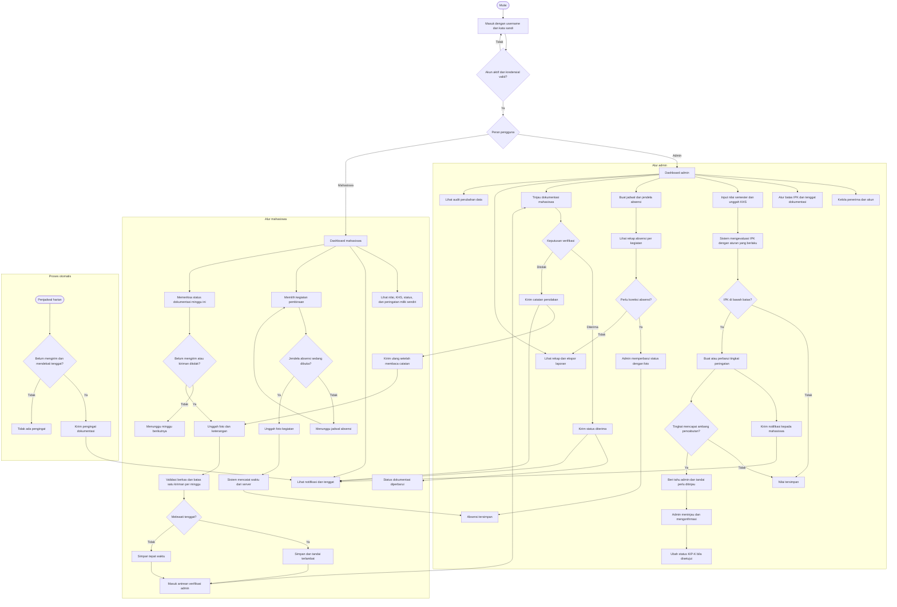

# Flowchart Sistem Pengelolaan KIP-K

## Batas akses

- Admin mengelola data penerima, nilai, aturan, kegiatan, verifikasi, dan laporan.
- Mahasiswa hanya melihat data miliknya sendiri; mahasiswa tidak dapat mengubah nilai.
- KHS dan foto disimpan privat dan hanya dapat diakses oleh admin atau pemilik data.
- Pencabutan status KIP-K dilakukan admin secara manual setelah konfirmasi.
